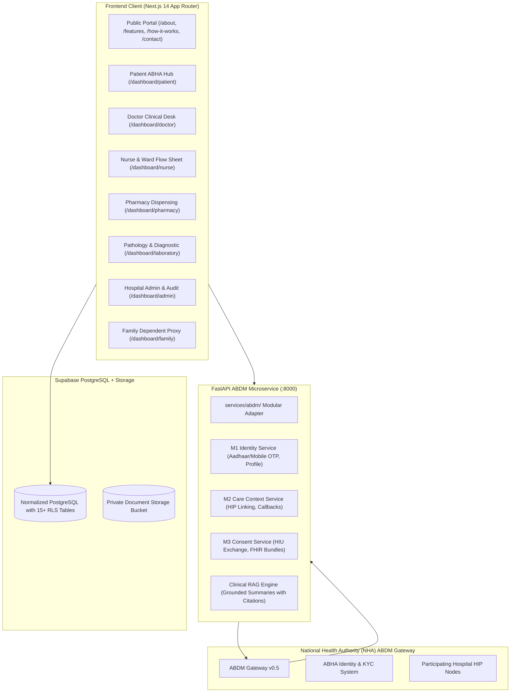

# MediSync — ABHA/ABDM-Integrated Healthcare Platform

[](https://abdm.gov.in)
[](https://nextjs.org)
[](https://fastapi.tiangolo.com)
[](https://supabase.com)
[]()

> **Tagline:** *"Connected Care. Healthier Lives."*

MediSync is an enterprise hospital-based healthcare platform designed to integrate with India's **Ayushman Bharat Digital Mission (ABDM)** ecosystem. It bridges hospital electronic medical records (EMR) with verified **ABHA (Ayushman Bharat Health Account)** identities across Milestone 1 (M1 - Identity Creation & Verification), Milestone 2 (M2 - HIP Care Context Linking), and Milestone 3 (M3 - HIU Consent-based Health Information Exchange).

---

## 1. Professional White-and-Blue Healthcare Design System

The platform features a clean, high-trust healthcare SaaS interface built with Tailwind CSS:
* **Primary Medical Blue (`#1769D2`)**: Primary action buttons, brand accents, and active focus states.
* **Dark Navy (`#12315B`)**: High-contrast typography, section headings, and top ecosystem bar.
* **Secondary Blue (`#3687E8`)**: Context linking indicators, sub-navigation, and highlights.
* **Light Blue (`#F3F8FF`)**: Background cards, status chip backdrops, and active row highlights.
* **White (`#FFFFFF`)**: Dominant backdrop ensuring clinical legibility.
* **Text (`#1E293B`, `#64748B`)**: Accessible typography meeting WCAG AA standards.
* **Borders (`#DCE7F3`)**: Subtle dividers providing clean visual structure.

---

## 2. System Architecture



---

## 3. ABDM Milestone Implementations

### Milestone 1 (M1) — Identity Creation & Verification
* **Decoupled Security**: MediSync login credentials are strictly separate from the patient's ABHA number. An ABHA number is never used as a password.
* **Existing ABHA Association**: Verifies existing ABHA numbers and addresses via official OTP challenges. Validates payloads on the server and maps verified profiles to stable internal patient IDs (`MS-PAT-2026-XXXX`).
* **Sandbox ABHA Creation**: Supports creating sandbox ABHA accounts with real-time address reservation and identity association.

### Milestone 2 (M2) — Hospital Care-Context Linking (HIP)
* **Standardized Grouping**: Hospital encounters, digital prescriptions, and lab reports are organized into standardized care contexts.
* **Linking Lifecycle**: Executes discovery (`/v0.5/care-contexts/discover`), link initiation (`/v0.5/links/link/init`), OTP validation, and gateway notification (`/v0.5/links/link/on-add-contexts`).
* **Status Badges**: Employs accurate lifecycle states: `NOT_LINKED`, `DISCOVERED`, `LINK_PENDING`, `LINKED`, and `FAILED`.

### Milestone 3 (M3) — Consent-Based Health Information Exchange (HIU)
* **Patient Autonomy**: Doctors request cross-hospital longitudinal medical history specifying clinical purpose (`CAREMGT`), date range, and record categories.
* **Verifiable Approvals**: Patients approve or deny requests directly on their ABHA mobile app.
* **Encrypted Ingestion**: External FHIR R4 clinical bundles are ingested, preserving source facility attribution and clinician signatures.
* **Revocation Support**: Patients can revoke active consents at any time, immediately halting future data queries.

---

## 4. Hospital Role Portals

| Role | Portal Path | Key Capabilities |
| :--- | :--- | :--- |
| **Patient** | `/dashboard/patient` | Dedicated ABHA M1/M2/M3 hub, unified records timeline, digital prescriptions, released lab reports, and AI summary drawer. |
| **Doctor** | `/dashboard/doctor` | Patient queue, OPD consultation notes, digital prescription writer, lab order requisitions, and cross-hospital record viewer. |
| **Nurse** | `/dashboard/nurse` | Inpatient flow sheet, real-time SpO2/BP/HR/temp charting with Recharts visual trend graphs, and ward care checklists. |
| **Pharmacy** | `/dashboard/pharmacy` | Active prescription queue, dosage validation, batch number tracking, and inventory dispensing logs. |
| **Laboratory** | `/dashboard/laboratory` | Diagnostic worklist, multi-parameter test result recording, reference range flags (HIGH/NORMAL), and report release with digital signature. |
| **Admin** | `/dashboard/admin` | Facility HFR/HPR registration, live gateway connectivity monitor, protocol v0.5 latency diagnostics, and immutable audit logs. |
| **Family** | `/dashboard/family` | Dependent proxy access for children (Aarav Sharma) and elderly family members with pediatric immunization tracking. |

---

## 5. Grounded AI Clinical Synthesis

* **FastAPI Endpoint**: `/api/ai/summarize`
* **Source Grounding**: Synthesizes verified electronic medical records without hallucinating unlisted diagnoses or drugs.
* **Explicit Citations**: Every finding cites specific record IDs, authoring clinicians, facilities, and dates.
* **Mandatory Advisory**: Embeds clear clinical disclaimers reminding practitioners that AI outputs are for informational reference only and do not replace professional evaluation.

---

## 6. Database Migrations & Seed Data

The database schema is organized under `supabase/migrations/20261009000001_initial_schema.sql` and `supabase/seed.sql`:
* `profiles`, `user_roles`, `organizations`, `organization_members`
* `patient_profiles`, `practitioner_profiles`, `practitioner_verifications`
* `patient_abha_links`, `care_contexts`, `care_context_link_events`
* `encounters`, `clinical_notes`, `medical_records`
* `prescriptions`, `prescription_items`, `dispensing_records`
* `lab_orders`, `lab_reports`, `vital_observations`, `care_tasks`
* `patient_consents`, `consent_exchange_requests`, `audit_logs`
* **Row Level Security (RLS)**: Enforced across all tables to safeguard patient privacy.

---

## 7. Setup & Execution Instructions

### Prerequisites
* Node.js v18+ (tested on v24.21.0)
* Python 3.11+ (tested on Python 3.14.5)

### Backend (FastAPI Microservice)
```powershell
# Navigate to backend directory
cd backend

# Create virtual environment & install dependencies
py -m venv venv
.\venv\Scripts\pip.exe install -r requirements.txt

# Run automated integration test suite
.\venv\Scripts\pytest.exe -o pythonpath=. .\tests\test_abdm.py

# Start FastAPI development server on port 8000
.\venv\Scripts\uvicorn.exe app.main:app --host 0.0.0.0 --port 8000 --reload
```

### Frontend (Next.js Application)
```powershell
# Navigate to frontend directory
cd frontend

# Install dependencies
npm install

# Run production build (type checking + static compilation)
npm run build

# Start production server on port 3000
npm run start
```

---

## 8. Test Execution Summary

### Automated Backend Tests (`pytest`)
All 6 backend integration tests executed and passed with 100% success rate:
* `test_health_check`: Passed (HTTP 200, status: HEALTHY)
* `test_abdm_integration_status`: Passed (M1, M2, M3 active)
* `test_m1_existing_abha_verification`: Passed (Challenge dispatch + OTP confirmation)
* `test_m2_care_context_linking`: Passed (Discovery + linking challenge + confirmation)
* `test_m3_consent_and_record_exchange`: Passed (Consent request + grant + record fetch)
* `test_ai_clinical_summary`: Passed (Grounded summary + active medications + citations)

### Frontend Compilation (`next build`)
All 22 Next.js App Router routes compiled cleanly into optimized static pages:
* `/` (Landing page)
* `/about`, `/features`, `/how-it-works`, `/contact`, `/privacy`, `/terms`
* `/login`, `/signup`, `/forgot-password`
* `/dashboard`, `/dashboard/patient`, `/dashboard/doctor`, `/dashboard/nurse`, `/dashboard/pharmacy`, `/dashboard/laboratory`, `/dashboard/admin`, `/dashboard/family`

---

## 9. Remaining ABDM Onboarding Requirements for Production

For deploying MediSync into a live hospital production environment:
1. **NHA Sandbox Registration**: Apply for official developer sandbox credentials at [developer.abdm.gov.in](https://developer.abdm.gov.in) to replace simulation keys.
2. **Health Facility Registry (HFR)**: Register MediSync Apex Hospital in the national facility registry to acquire an official production HFR Facility ID.
3. **Healthcare Professional Registry (HPR)**: Register hospital physicians and surgeons to issue official HPR IDs.
4. **Third-Party Security Audit**: Complete an independent CERT-In certified cybersecurity audit of the hospital deployment.
5. **NHA Milestone Certification**: Submit integration test logs for M1, M2, and M3 to the National Health Authority for formal production clearance.
